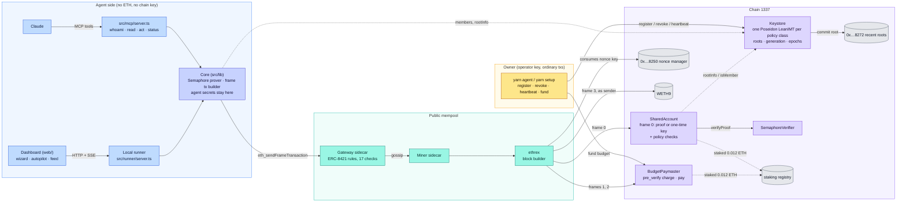
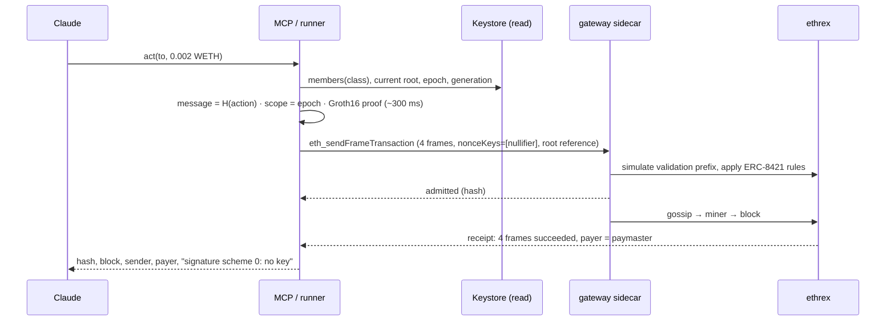

# AnonAI

**Full-stack privacy for autonomous AI agents.** An AI agent acts on Ethereum with no private key, no ETH
and no name: it proves it is authorised with a Semaphore v4 zero-knowledge membership proof, sends from one
shared account that many agents of many owners use, and a paymaster pays its gas from a budget the owner
set. Built on EIP-8141 frame transactions and the ERC-8421 standard alt-mempool (public devnet, chain 1337),
with EIP-8250 keyed nonces, EIP-8272 recent roots, and Anon-RPC for the dashboard's reads.

Live on the devnet since 2026-11-06: both authorisation modes mined end to end, the canonical mempool's
rejection reproduced, rate limiting and revocation demonstrated, a Claude agent driving it through MCP.

- Try it from Claude: see [Give Claude the tools](#give-claude-the-tools-mcp).
- Dashboard with a live, animated run: see [Dashboard and runner](#dashboard-and-runner).
- Design decisions, verified devnet facts, measured gas: [`docs/SPEC.md`](docs/SPEC.md).

## Why

An agent-wallet today holds a raw key on a server, keeps ETH on it for gas, and acts from one address that
anyone can tie to its owner. AnonAI removes all three. It is only possible on the alt-mempool: the proof check
costs about 300k validation gas and the account reads a foreign contract; the paymaster reads and writes its
own budget table in a `pre_verify` frame. EIP-8141's canonical mempool caps validation at 100k gas and allows
only the sender's own storage, so the identical transaction is rejected there (the demo shows both).

## Architecture



Yellow: the owner. Blue: the agent side (Claude, the dashboard, and the local core that holds the secrets).
Teal: the public mempool. Purple: the four contracts this project deploys. Grey: devnet predeploys.

One action is one frame transaction with four frames:

| # | frame | target | what runs | measured gas |
|---|---|---|---|---|
| 0 | `only_verify` (VERIFY) | SharedAccount | frame layout and policy checks against the body frame; nonce key must equal the nullifier; Keystore root is current-generation and its epoch matches the proof's scope; Groth16 verify; `APPROVE(EXECUTION)` | 296,823 (zk) · 53,591 (key) |
| 1 | `pre_verify` (DEFAULT) | BudgetPaymaster | `budget[class] -= TXPARAM(MAX_COST)`, charge receipt under `TXPARAM(SIG_HASH)` | 42,127 |
| 2 | `pay` (VERIFY) | BudgetPaymaster | requires this transaction's receipt, `APPROVE(PAYMENT)` | 27,437 |
| 3 | body (SENDER) | WETH | `transfer(to, amount)` with the shared account as `msg.sender` | 30,262 |

Transaction fields: `sender` = SharedAccount; `signatures` = one scheme-0 (ARBITRARY) entry in zk mode, a
scheme-1 one-time key in key mode; `nonceKeys = [nullifier]` (or the one-time address), `nonceSeq = 0`;
`recentRootReferences = [{ keccak(keystore‖class), slot, root }]`.



## Two authorisation modes

| | `zk` (default) | `key` |
|---|---|---|
| credential | Semaphore identity; its commitment is a leaf in the class tree | a batch of one-time secp256k1 keys; each address is a leaf |
| what the chain sees | a proof, a nullifier, the policy class; signature scheme 0 | the one-time address; signature scheme 1 |
| who can tell which agent acted | nobody: the proof says "one of the class" | anyone who joins the key's registration to the action |
| one action per | epoch (nullifier = nonce key, enforced by the protocol) | key (address = nonce key) |
| validation gas | ≈ 297k | ≈ 54k |
| needs | bn254 precompiles allowed by the sidecar (they are, since 2026-11-06) | nothing special |

**Capacity.** Semaphore proves against trees up to depth 32 (2³² members). AnonAI fixes the proof depth at 10
(`MERKLE_DEPTH` in `src/lib/semaphore.ts`), so a policy class holds up to 1,024 members. Raising the constant
is the only change: the verifier already holds keys for every depth, the Keystore tree grows on its own,
verification gas stays the same and proving time grows a few milliseconds per level.

## Quickstart (owner side)

Needs Node 22+ (25 works), yarn v1, and Foundry only if you change the contracts (artifacts are committed).

```sh
git clone https://github.com/anonai-ef/AnonAI && cd AnonAI
yarn install --ignore-engines
yarn setup                                   # faucet → PoseidonT3 (CREATE2 proxy) → verifier → Keystore → account → paymaster → stake both
yarn agent fund weth-0.01 0.05               # gas budget for the policy class (the runner tops it up automatically)
yarn agent treasury 0.05                     # wrap ETH and give the shared account WETH to spend
yarn agent new claude --mode zk  --class weth-0.01
yarn agent new alice  --mode key --class weth-0.01 --keys 8
yarn act claude 0x8943545177806ED17B9F23F0a21ee5948eCaa776 0.002          # proof → alt-mempool → mined
yarn act claude 0x8943545177806ED17B9F23F0a21ee5948eCaa776 0.002 --canonical   # same bytes to ethrex: rejected
yarn agent heartbeat weth-0.01               # next epoch
yarn agent revoke claude                     # bumps the class generation; older proofs are refused in frame 0
```

| command | does |
|---|---|
| `yarn setup [--fresh] [--redeploy paymaster,account]` | idempotent deploy and stake; `--fresh` after a devnet reset |
| `yarn agent new <name> --mode zk\|key --class <class> [--keys n]` | register an agent (its secret stays in `.anonai-state.json`) |
| `yarn agent revoke <name>` · `heartbeat <class>` · `fund <class> <eth>` · `treasury <eth>` · `list` | owner operations |
| `yarn act <agent> <to> <weth> [--canonical] [--estimate] [--prepare f.json]` · `yarn act --send-prepared f.json` | one action; prepare/send lets you show a stale proof refused after a revocation |
| `yarn simulate <agent> <to> <weth>` | ethrex dry run with per-frame gas and the ERC-7562 trace |
| `yarn debug <txHash>` | the sidecar's rule-by-rule admission report, lifecycle, receipt; revert reasons decoded |
| `yarn probe` | asks ethrex what each EIP-8141 introspection opcode returns (dev aid) |
| `yarn runner` · `yarn export:web` · `yarn build:contracts` · `yarn test:contracts` | runner on :8787; dashboard facts; contracts |

Policy classes live in `src/lib/policies.ts` (`weth-0.01`, `weth-0.1`: WETH `transfer` up to the cap per
action). Config is `anonai.config.json5` only; generated state is `.anonai-state.json` (git-ignored).

## Give Claude the tools (MCP)

`src/mcp/server.ts` exposes `anonai_whoami`, `anonai_read`, `anonai_act`, `anonai_act_canonical` and
`anonai_status`. The server runs on your machine next to the agent secret; Claude never sees the secret.

```sh
claude mcp add anonai -- "$PWD/bin/anonai-mcp" --agent claude      # Claude Code
```

```json
{ "mcpServers": { "anonai": { "command": "/ABS/PATH/AnonAI/bin/anonai-mcp", "args": ["--agent", "claude"] } } }
```

Then, for example: *"Use AnonAI: check the treasury's WETH balance, then pay 0.002 WETH to
0x8943545177806ED17B9F23F0a21ee5948eCaa776. Tell me the tx hash, the block, who the chain saw as sender and
payer, and which signature scheme it carried."* `demo/` holds a ready `.mcp.json` and the agent's
instruction block (`demo/CLAUDE.md`); run `claude` inside it.

## Dashboard and runner

```sh
yarn runner                 # terminal 1: holds secrets, proves, submits, streams events (http://localhost:8787)
yarn --cwd web dev          # terminal 2: http://localhost:5173
```

- **Home**: what AnonAI is, MCP install for Claude Code and Claude Desktop, prompts to paste.
- **Live**: a first-run wizard (mode, policy class and agent, action and cadence), then an autopilot that keeps
  acting while a six-stage pipeline animates (agent → authorise → frame tx → gateway → miner → block), a
  "who can see what" panel with the private fields redacted, the anonymity set, buttons for *Try canonical
  mempool* and *Revoke this agent*. Every hash links to the devnet explorer.
- **Stack**, **Mempool feed** (every shared-account admission with the sidecar's report), **Story**.
- **Private reads** (header): routes every read the page makes through an Anon-RPC worker
  (`@anon-rpc/browser-harness`: a hash-pinned worker in a null-origin iframe; Tor, Nym or passthrough).
  The page reads directly until the worker is ready and falls back after 60 s. The runner's own reads stay
  direct: no Node harness exists.

The hosted site (GitHub Pages via `.github/workflows/pages.yml`, or any static host of `web/dist`) is live and
read-only for anyone; the Live tab works when the presenter's laptop runs the runner. `yarn export:web`
refreshes `web/public/anonai.json` (addresses, classes, agents' public data) after setup or registrations.

## Privacy model

| party | sees | does not see |
|---|---|---|
| gateway / miner sidecar | a tx from SharedAccount, payer BudgetPaymaster, a proof, a nullifier, a policy class, the body call, the submitting IP | which agent, which owner, the secret |
| chain / explorer | the same minus the IP; the nonce key consumed; the class budget decrement | which leaf of the class produced the proof |
| owner | its own agents' commitments and policies | other owners' agents; which action was theirs, unless the agent tells them |

The anonymity set is the policy class. Registrations are public, but a proof hides which member acted, so
registrations cannot be joined to actions. Key mode gives that up deliberately and the dashboard shows the
difference side by side. Remaining visible: the policy class per action, the action itself, the submitting IP
at the gateway, timing. Trust: Semaphore's Groth16 setup, the verifier contract, the devnet staking registry.

## Devnet facts worth knowing

Verified with `yarn probe` and live transactions (details and dates in `docs/SPEC.md`):

- The sidecar's validation gas limit is 10,000,000 and precompiles `0x01`–`0x11` are allowed (both set by the
  operator on 2026-11-06). The canonical mempool keeps 100k and sender-only storage.
- `FRAMEPARAM(…, STATUS)` faults on this ethrex build and transient storage does not survive between frames;
  the paymaster therefore binds `pay` to `pre_verify` with a receipt keyed by `TXPARAM(SIG_HASH)`.
- A frame that writes a new storage slot needs `limits.state`; code deposits cost ~38M gas (gas is estimated).
- Gateway gossip to the miner has dropped after restarts: transactions are also handed to the miner's sidecar.
- A reused nullifier surfaces as a misleading `MAX_VERIFY_GAS` message; the runtime pre-checks the nonce key.
- The faucet gives 1 ETH per address per hour. A devnet reset wipes contracts: `yarn setup --fresh`.

## Troubleshooting

| message | cause | fix |
|---|---|---|
| `AnonAI: budget exhausted` | the class gas budget ran out (each action reserves its max cost, ≈0.002 ETH) | `yarn agent fund <class> 0.05`; the runner tops up automatically |
| `prefix gas budget exceeded … MAX_VERIFY_GAS` from `eth_sendFrameTransaction` | the sidecar reporting a failed simulation (usually the above, or a reused nullifier) | `yarn debug <hash>`; the decoded reason is in the report |
| `EPOCH_USED` | the agent already acted in this epoch | `yarn agent heartbeat <class>` (the runner does it) |
| `NOT_A_MEMBER` | the agent was revoked | register a new one |
| `EADDRINUSE :::8787` | a runner is already running | `pkill -f runner/server.ts` |
| requests time out while "Private reads" bootstraps | the Tor demo gateway is slow or down | wait for the 60 s fallback, or pick Nym / passthrough |

## CROPS

**C** We control the Keystore, SharedAccount and BudgetPaymaster and nothing else; an owner redeploys all
three from this repo. Transactions go to the public decentralised mempool, never a private endpoint.
**O** MIT; contracts, prover, runtime, MCP, runner and dashboard build and run from the repo.
**P** The chain learns a policy class, a nullifier and a root; the sidecar also learns the submitting IP;
dashboard reads can leave through Anon-RPC. Nothing learns which agent or owner acted. No analytics.
**S** The operator key signs only Keystore and paymaster transactions; the agent holds one Semaphore
identity secret bounded by its policy and void after revocation.

## Layout

```
contracts/src     Keystore, SharedAccount, BudgetPaymaster, OpcodeProbe (dev aid)      contracts/test  forge tests (real proofs via FFI)
contracts/vendor  LeanIMT (vendored: forge mangles remappings ending in .sol)          contracts/artifacts  committed ABI + bytecode
src/lib           config, state, rpc, chain, frameTx, anonTx, semaphore, keys, keystoreClient, owner, staking, weth, policies, facts
src/cli           setup, agent, act, simulate, debug, probe, exportWeb                 src/mcp/server.ts  Claude's tools
src/runner        local runner for the dashboard (HTTP + SSE)                          bin/anonai-mcp     MCP launcher
web/              dashboard (Vite + React + viem + @anon-rpc/browser-harness)          demo/              .mcp.json + agent CLAUDE.md
docs/SPEC.md      build specification: decisions, verified facts, measured gas, plan   CLAUDE.md          instructions for agents working here
```

Tests: `yarn test:contracts` runs 31 forge tests; the SharedAccount suite generates real Semaphore proofs
through FFI (`forge test --root contracts --threads 1` if proofs run in parallel on a small machine).
