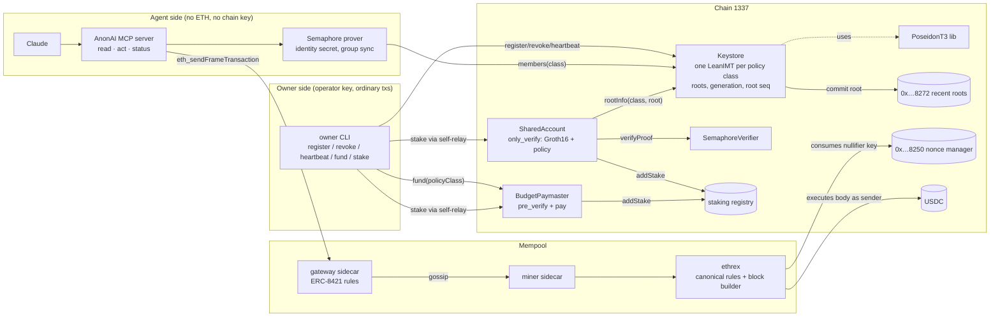
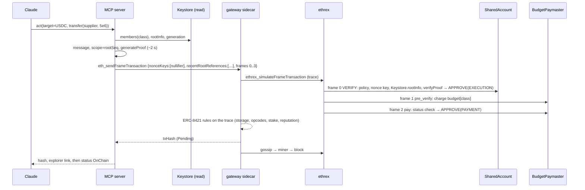

# AnonAI build specification

Version 1, 2026-11-06. This is the document a building agent follows. It supersedes the product
specification ("Agent keystore, permissions and gas sponsorship on EIP-8141") wherever the two differ,
because every claim here was checked against the live devnet, the sidecar source and the rules pages
on 2026-11-06. Section 0 lists the decisions and why.

Repository: `/Users/adrija/AnonAI` (name: **AnonAI**). Devnet: chain 1337, the public ERC-8421
alt-mempool devnet. Terminology is the workshop's: **sidecar** (the mempool node), **gateway** (the one
sidecar every request goes to), **canonical mempool** (EIP-8141's own rules, ethrex), **standard
alt-mempool** (the ERC-8421 rule set the sidecar implements), **staked entity**, **reputation**.

---

## 0. Decisions log

| # | Decision | Why |
|---|---|---|
| D1 | **Authorisation is a Semaphore v4 Groth16 membership proof**, verified in the shared account's `only_verify` frame. The Merkle-plus-one-time-key fallback is dropped. | The devnet operator removed the validation gas cap on 2026-11-06 (`validationGasLimit` is now 10,000,000; the flat 100k constant is gone). ZK is strictly stronger privacy: it hides *which* registered credential acted, so public registration does not link actions to owners. |
| D2 | **Nullifier = EIP-8250 nonce key**, `nonceSeq = 0`, never reused. | The protocol itself rejects a second use (nonce mismatch). No nullifier storage, no state write in VERIFY. The account additionally checks `TXPARAM(NONCE_KEY_0) == proof.nullifier`. |
| D3 | **Scope = the keystore's root sequence number for the policy class** (one action per agent per committed root, i.e. per heartbeat). | Validation code may not read `TIMESTAMP`/`NUMBER`/`SLOTNUM`. The root sequence is the only clock a VERIFY frame can see, and it is stable once written, which keeps reputation safe. |
| D4 | **Roots are bookkept in the Keystore and also committed to the EIP-8272 predeploy; the account validates against the Keystore, the transaction declares the predeploy reference.** | The `0x…8272` predeploy is write-only (its code accepts exactly `salt‖root`, 64 bytes, and `SSTORE`s; there is no getter), and no `TXPARAM` exposes declared references. So on this devnet a contract cannot check a declared root itself. The Keystore is the on-chain source of truth; the declared reference gives the mempool its freshness/eviction behaviour and demonstrates EIP-8272. |
| D5 | **One Semaphore group (LeanIMT) per policy class.** The proof's root reveals the class; budgets are keyed by class. | A single tree cannot bind an identity commitment to a policy. Anonymity set = members of the class. Owners choose from a small catalogue of classes so classes are shared. |
| D6 | **Revocation = remove the leaf and bump the class `generation`.** The account requires the proof's root to belong to the current generation. | Old roots stay valid inside a generation (so pending transactions are not invalidated by routine registrations), but a revocation invalidates every older root at once. Revocation is immediate at the next block. |
| D7 | **Anon-RPC is out of scope for v1.** The read path is a plain RPC to ethrex. | No Node harness exists (only `@anon-rpc/browser-harness`, iframe + Web Worker + WebRTC). Revisit only if everything else is done. |
| D8 | **Paymaster budgets are charged in a `pre_verify` frame with `TXPARAM(MAX_COST)`; the `pay` frame checks the pre_verify status and a transient flag.** | Already built and unit-tested (`contracts/src/BudgetPaymaster.sol`). |
| D9 | **Both the shared account and the paymaster stake 0.012 ETH** at the NaiveStakingRegistry. | A staked entity may read any storage of non-entity contracts (STORAGE-032) and its own storage as payer (STORAGE-031). The account needs a `view` call into the Keystore and the verifier; the paymaster needs its own budget table. |
| D10 | **Submission only through the public gateway's `eth_sendFrameTransaction`.** Never `ethrex_submitPrivilegedFrameTransaction`, never the genesis key, never `debug_*`. | Operator guidance: private submission is "not CROPS"; privileged use of the public ethrex is at our own risk. |
| D11 | **Fallback if the gateway's precompile allowlist is not fixed in time: a local sidecar with the single config change `precompiles = [0x01..0x0a]`.** | Live `skandha_config` still returns `precompiles: []`, so the sidecar's code-access rule refuses `STATICCALL` to `0x06/0x07/0x08` as "un-deployed contract". The operator said a documented config-only change is acceptable for judging and offered to fix the public node. Ask in the Telegram group first (section 13). |

---

## 1. Problem statement

An autonomous AI agent that acts on Ethereum today has to hold a raw private key on a server, keep
ETH on that key for gas, and act from one public address that anyone can tie to its owner. Every
agent-wallet product on the market (session keys on ERC-4337 and EIP-7702, ERC-8004 identity) keeps
all of those properties; ERC-8004 makes the owner link explicit by design.

AnonAI replaces each one:

- **Keys and permissions live as hidden commitments** in a Keystore contract the owner controls.
- **The agent proves it is authorised with a zero-knowledge proof instead of a signature**, from one
  shared account that many agents of many owners use. Nothing on chain names the agent or its owner.
- **A paymaster pays gas from a budget the owner funded**, so the agent never holds ETH.
- **Keyed nonces** let one shared sender carry many agents' actions in flight at once.

It is only possible on the standard alt-mempool: a Groth16 check costs about 300k gas and reads a
foreign contract; a stateful paymaster reads and writes its own budget table. The canonical mempool
rejects both. The EF's own use-cases page lists keystore contracts, stateful paymasters, privacy
protocols and zero-knowledge proofs as the four things the alt-mempool exists to admit. AnonAI is all
four, for one user: the agent. The demo agent is Claude, driving the stack through MCP tools.

### Goals (hackathon)

1. A Claude agent pays a supplier in USDC from the shared account with zero ETH and no key of its own.
2. Two agents' transactions sit in the mempool and on chain indistinguishable except by nullifier.
3. The identical transaction is rejected by the canonical mempool (side-by-side shot).
4. Revocation: the owner revokes agent A, A's next action is rejected, B still works.
5. Per-epoch rate limit: a second action by the same agent on the same root is rejected by the nonce.

### Non-goals

Per-epoch spend accumulation (replaced by one action per epoch with a per-action cap), cross-chain
roots, gas refunds to budgets, a UI beyond a CLI (an owner dashboard is a stretch), Anon-RPC (D7).

---

## 2. Verified environment facts

| Fact | Value | Verified how |
|---|---|---|
| Gateway (sidecar) | `https://altmempoolgateway.forshtat.com/rpc` | `web3_clientVersion`, `skandha_config` |
| ethrex (execution) | `https://altmempool.forshtat.com` | `web3_clientVersion` = ethrex `eip8141-tracer` `9aa3645d` |
| Explorer | `https://explorer.altmempool.wtf/` | `skandha_explorer_info` |
| Chain id, block time | 1337, 6 s slots | config, blocks |
| Validation gas | `validationGasLimit: 10_000_000`, no per-entity cap enforced | live `skandha_config` after the 2026-11-06 restart |
| Precompiles allowed by the sidecar | **`precompiles: []`** (blocker, see D11) | live `skandha_config` |
| Staking registry | `0xd51c04d7a0b01124e84de152f4e56d9eecb22d2f`, `minStake` 0.01 ETH, `addStake(uint32 unstakeDelaySec)` payable, keyed on `msg.sender` | workshop step 7 |
| `NONCE_MANAGER` | `0x…8250`, next seq of `(sender,key)` at `keccak256(pad32(sender)‖uint256(key))` | workshop step 12 |
| `RECENT_ROOT_ADDRESS` | `0x…8272`, write-only (`salt‖root`, 64 bytes), entry hash `keccak("RECENT_ROOT_ENTRY"‖sourceId‖u64(slot)‖root)` at key `keccak("RECENT_ROOT_STORAGE"‖sourceId‖u64(slot mod 8192))`, `sourceId = keccak(caller‖salt)`; usable while `1 ≤ head_slot+1−slot ≤ 8191` | workshop step 13, bytecode |
| USDC (real bytecode, 6 decimals) | `0xEFe0D421fD473564c9C9b0cDCeB194cF476D6AF5`, deployer can `mint` | predeploy table |
| Signature schemes | `0` ARBITRARY (intrinsic cost 100), `1` SECP256K1 (2,800), `2` P256 (6,700) | sidecar `validationPrefix.ts` |
| Prefix shape used | `[only_verify, pre_verify, pay]` then the body; pre_verify must immediately precede the approving frame of the same target | PREFIX-010/110 |
| Storage in validation | sender: own storage; staked entity: own storage, read-only any non-entity contract's storage (STORAGE-031/032) | rules/storage |
| Opcodes banned in validation | `TIMESTAMP NUMBER SLOTNUM COINBASE GASPRICE BLOCKHASH PREVRANDAO GASLIMIT BASEFEE BLOBBASEFEE GAS` (except before `*CALL`), `CREATE*`, `SELFDESTRUCT`; `BALANCE/SELFBALANCE` only when staked; precompiles `0x01`–`0x11` allowed by rule (CALLING-040) but gated by the sidecar's `precompiles` config | rules/opcodes, Telegram |
| Pending-count rules in the sidecar | one pending tx per `(sender, key)`; no per-sender cap on keyed txs; linear txs capped at 4 per sender | guides/keyed-nonces |
| Reputation | `opsSeen` grows on every admission, `opsIncluded` on inclusion; a tx relayed 4 times without inclusion is cancelled and hurts the entity; fresh entities reset it | Telegram, explorer |
| Opcode helpers | `@forshtat/hegota-support` deploys 7 helper contracts per inheriting contract (nonces 1..7: Approve, TxParam, FrameDataLoad, FrameDataCopy, FrameParam, SigParam, SigDataCopy); the frame's data is the fallback's `msg.data` | library source, workshop contracts |
| Semaphore v4 | `@semaphore-protocol/{contracts,proof,identity,group}@4.14.5`; verifier `verifyProof(uint[2] pA, uint[2][2] pB, uint[2] pC, uint[4] pubSignals, uint depth) view`; public signals `[root, nullifier, _hash(message), _hash(scope)]` with `_hash(x) = uint256(keccak256(abi.encodePacked(x))) >> 8`; LeanIMT via `@zk-kit/lean-imt.sol` using `PoseidonT3.hash` (a **public library function: needs linking**) | package sources |

---

## 3. Architecture



Three sides meet only in the shared account's VERIFY frame: the owner's registrations (Keystore
roots), the agent's proof (frame data), and the chain's enforcement (keyed nonce, staking, payer).

---

## 4. Data model

### 4.1 Policy and policy class

```solidity
struct Policy {
    address target;     // the one contract the agent may call (USDC in the demo)
    bytes4  selector;   // required 4-byte selector, or 0x00000000 for any
    uint256 maxValue;   // max ETH value of the body frame (0 in the demo)
    uint256 maxAmount;  // cap on calldata word at offset 36 (the `amount` of transfer(address,uint256)); type(uint256).max = no cap
}
bytes32 policyClass = keccak256(abi.encode(policy));
```

The policy is **not stored on chain**. The agent supplies it in frame data and the account checks its
hash equals the class the proof was made for. The owner side ships a small catalogue (for example
`usdc-10` = USDC transfers up to 10 USDC, `usdc-100`), so many agents share each class.

### 4.2 Identity, group, proof

- Agent identity: Semaphore `Identity(secret)`; `commitment = identity.commitment` (a Poseidon hash;
  nothing about the owner).
- Group per class: the Keystore's LeanIMT of commitments. The prover rebuilds it from
  `Keystore.members(class)` (array getter) or `MemberAdded`/`MemberRemoved` events.
- Proof: `generateProof(identity, group, message, scope, MERKLE_DEPTH = 10)` from
  `@semaphore-protocol/proof`. Fixed depth 10 (1,024 members per class) keeps verifier gas constant.
  Returns `{ merkleTreeDepth, merkleTreeRoot, nullifier, message, scope, points[8] }`.
- `scope = rootSeq` (section 4.4). `nullifier = poseidon(scope, secret)` is unique per (agent, root).
- `message` binds the proof to the exact action (section 4.3).

### 4.3 Message binding

```
message = uint256(keccak256(abi.encode(
            "AnonAI.action.v1", chainId, account, policyClass,
            target, value, keccak256(bodyCalldata)))) >> 8
```

The account recomputes `message` from the real body frame via `FRAMEPARAM`/`FRAMEDATACOPY` and feeds
`_hash(message)` to the verifier. A proof is therefore valid for one call only; the sidecar or anyone
else cannot redirect it.

### 4.4 Keystore state (per class)

| Field | Meaning |
|---|---|
| `LeanIMTData tree` | Poseidon LeanIMT of commitments |
| `uint256[] members` | leaves in insertion order (removed leaves become 0, indices stay) |
| `uint32 generation` | bumped on every revocation |
| `uint64 rootSeq` | counter of committed roots (registration, revocation, heartbeat) |
| `mapping(root => RootInfo{seq, generation})` | every root ever committed |
| `uint64 lastCommitBlock` | heartbeat spacing (`EPOCH_BLOCKS`, demo value 5) |
| `mapping(commitment => address registrant)` | who may revoke a leaf |

`commit(class)`: `rootSeq++`, store `RootInfo`, call `0x…8272` with `salt = class`, `root` (so
`sourceId = keccak(keystore ‖ class)`), emit `RootCommitted(class, seq, root)`. The owner CLI reads the
receipt's block to learn the **slot** for the transaction-level reference.

### 4.5 Agent runtime state (`.anonai-state.json`, git-ignored)

operator key; deployed addresses (poseidon, verifier, keystore, account, paymaster); per agent:
name, secret, policy, policyClass, commitment; last tx hash; per class: last known rootSeq/root/slot.

---

## 5. The transaction, frame by frame

| # | Frame | Mode / flags | Target | Data | What runs | `limits.execution` |
|---|---|---|---|---|---|---|
| 0 | `only_verify` | VERIFY, `0x2` | `null` (= SharedAccount) | `abi.encode(AuthInput)` | policy checks, nonce binding, root/generation check in Keystore, Groth16 verify, `APPROVE(EXECUTION)` | 400,000 |
| 1 | `pre_verify` | DEFAULT, `0x0` | BudgetPaymaster | `policyClass` (32 bytes) | `budget[class] -= TXPARAM(MAX_COST)`, `tstore(ARMED)` | 60,000 |
| 2 | `pay` | VERIFY, `0x1` | BudgetPaymaster | empty | `FRAMEPARAM(1, STATUS) == 1`, `tload(ARMED)`, `APPROVE(PAYMENT)` | 40,000 |
| 3 | body | SENDER, `0x0` | `policy.target` | the call | the action, `msg.sender` = SharedAccount | as needed (USDC transfer: 120,000, `limits.state` 200,000) |

Transaction fields:

- `sender`: SharedAccount. `signatures`: one entry, scheme `0` ARBITRARY, empty signer/msg/signature.
- `nonceKeys: [nullifier]`, `nonceSeq: 0`. A reused nullifier is a nonce mismatch (`RPC_-32500`).
- `recentRootReferences: [{ sourceId: keccak(keystore‖class), slot, root }]` for the root the proof used.
- `fees.maxFeePerGas = 2 gwei` (config). The paymaster, not the sender, must hold ETH.



---

## 6. Validation logic

### 6.1 SharedAccount, frame 0 (`fallback`, `msg.data = abi.encode(AuthInput)`)

```solidity
struct AuthInput {
    Policy  policy;          // hashed to policyClass
    uint256 merkleTreeDepth; // 10
    uint256 merkleTreeRoot;
    uint256 nullifier;
    uint256 scope;           // == rootSeq of merkleTreeRoot in the Keystore
    uint256[8] points;
}
```

```mermaid
flowchart TD
  S([frame 0 entered]) --> R0{msg.data.length == 1?}
  R0 -- yes --> ADM[admin path: SIGPARAM signer == admin → APPROVE both\nused once to stake itself] --> END
  R0 -- no --> P1[policyClass = keccak(policy)]
  P1 --> P2{FRAME_COUNT == 4\nFRAMEPARAM(3).target == policy.target\nvalue <= maxValue\nselector / amount caps}
  P2 -- fail --> X([revert])
  P2 --> P3{FRAMEDATALOAD(0, frame 1) == policyClass}
  P3 -- fail --> X
  P3 --> P4{NONCE_KEY_COUNT == 1 and NONCE_KEY_0 == nullifier}
  P4 -- fail --> X
  P4 --> P5[Keystore.rootInfo(class, root) → seq, gen]
  P5 --> P6{seq != 0 and gen == Keystore.generation(class) and scope == seq}
  P6 -- fail --> X
  P6 --> P7[message = keccak(domain, chainId, this, class, target, value, keccak(calldata)) >> 8]
  P7 --> P8{Verifier.verifyProof(pA, pB, pC, [root, nullifier, hash(message), hash(scope)], depth)}
  P8 -- false --> X
  P8 -- true --> OK[APPROVE EXECUTION]
  OK --> END([frame ends])
```

Rules it must respect: no environment opcodes; only `STATICCALL`s to the Keystore (non-entity contract,
read-only, allowed because the account is staked) and to the verifier (pure code plus precompiles
`0x06/0x07/0x08`); no storage writes; revert with a reason, never out-of-gas (OPCODES-040).

What the protocol enforces for us: the ARBITRARY signature (nothing), the nonce key's single use, the
declared recent-root reference being committed and inside the window, the payer's solvency.

### 6.2 BudgetPaymaster (built, `contracts/src/BudgetPaymaster.sol`)

- `fallback`: 32-byte data → pre_verify; empty data → pay; 1-byte data → admin self-stake path (to add).
- pre_verify: `TXPARAM(SENDER) == account`, `budget[class] >= TXPARAM(MAX_COST)`, subtract, `tstore`.
- pay: `TXPARAM(CURRENT_FRAME_INDEX) = i`, `FRAMEPARAM(i-1, STATUS) == 1`, `tload == 1`, `APPROVE(PAYMENT)`.
- Reads/writes only its own storage: allowed because it is staked (STORAGE-031). Budgets are keyed by
  class, so its storage names no owner.

### 6.3 Keystore (ordinary transactions, no validation rules)

`register(class, commitments[])`, `revoke(class, commitment, siblings[])` (registrant only; bumps
`generation`), `heartbeat(class)` (anyone, spaced by `EPOCH_BLOCKS`), each ending in `commit(class)`.
Views: `members(class)`, `rootInfo(class, root)`, `generation(class)`, `rootSeq(class)`.

### 6.4 Who enforces what

| Property | Enforced by |
|---|---|
| Only a registered, unrevoked agent of the class can act | Groth16 proof + Keystore `rootInfo`/`generation` check in frame 0 |
| Within policy (target, selector, amount, value) | frame 0 against the real body frame |
| One action per agent per committed root | nonce key = nullifier (protocol) + `NONCE_KEY_0` binding (frame 0) |
| Budget per class, agent holds no ETH | pre_verify charge + pay approval (paymaster) + payer solvency (protocol) |
| Transaction freshness in the mempool | declared recent-root reference (sidecar window check, eviction) |
| No key, agent or owner on chain | by construction: ARBITRARY signature, shared sender, class-keyed budgets |

---

## 7. Privacy analysis

| Party | Sees | Does not see |
|---|---|---|
| Gateway / miner sidecar | a tx from SharedAccount, payer BudgetPaymaster, a proof, a nullifier, a policy class, the body call, **the submitting IP** | which agent, which owner, the agent secret |
| ethrex / chain / explorer | the same minus the IP; nonce key consumed; budget decrement for the class | which leaf of the class produced the proof |
| Owner | its own agents' commitments and policies | other owners' agents |
| Agent | its own secret and policy, the group's commitments (public) | anything about other agents beyond public commitments |

- **Anonymity set** = members of the policy class. Registration transactions are public, but the proof
  hides which member acted, so joining registrations to actions is not possible (this is what the
  Merkle-only design could not offer).
- **Unlinkability of actions**: nullifiers differ per root, messages differ per action. Two actions
  by the same agent on different roots are unlinkable to each other and to the agent.
- **What remains visible**: the policy class per action (mitigated by shared classes), the action
  itself (the body is a normal call), the submitting IP at the gateway (Anon-RPC would hide the read
  side; private submission is unsupported), and timing.
- **Trust assumptions**: Semaphore's Groth16 trusted setup; the verifier contract's correctness; the
  staking registry; the operator key for registration (never the agent).

---

## 8. Mempool-rule compliance, gas and reputation

### 8.1 Why ~300k of validation gas is acceptable (answer to the operator's ask)

- The cost is **bounded and deterministic**: one Groth16 verification (four pairings plus four scalar
  multiplications), one `view` call to the Keystore, about ten opcode-helper calls. No loops over
  user-controlled lengths. We publish the measured number.
- **Nobody can make the node waste it**: a transaction's validity depends only on data that cannot be
  changed by third parties (committed roots and the class generation). The only way to invalidate a
  pending transaction is a revocation by its own registrant.
- **The sender is staked** and bears the reputation of its transactions, and every transaction consumes
  a fresh nonce key, so there is no free replay or spam path.
- It is the same order of magnitude as the privacy-pool projects on this devnet (215k to 321k) and the
  landing page's own "minimal proof check about 200k".

### 8.2 Storage and opcode rules touched

| Access | Rule | Status |
|---|---|---|
| Account `STATICCALL` Keystore views (Keystore `SLOAD`s) | STORAGE-032 (staked, read-only, non-entity) | allowed once staked |
| Account `STATICCALL` verifier → precompiles `0x06/0x07/0x08` | CALLING-040 | allowed by rule; **gated by sidecar `precompiles` config (D11)** |
| Paymaster `SLOAD/SSTORE/TSTORE/TLOAD` own storage | STORAGE-031 (staked) | allowed once staked |
| Everything in canonical mempool | only sender's own storage | rejected (intended, demo shot) |

### 8.3 Gas budget (estimates; measure with `eth_estimateFrameTransactionGas` and `ethrex_simulateFrameTransaction` before fixing limits)

| Frame | Estimate | Limit to set |
|---|---|---|
| 0 only_verify | verifier ≈ 230k, helpers ≈ 40k, Keystore call ≈ 8k, hashing ≈ 5k → ≈ 290k | 400k |
| 1 pre_verify | ≈ 35k | 60k |
| 2 pay | ≈ 20k | 40k |
| 3 body (USDC transfer) | ≈ 60k + state gas | 120k exec, 200k state |

### 8.4 Reputation hygiene

- Build proofs against the **latest** committed root of the class and declare that root's slot.
- Do not submit while a registration/revocation is in flight for the class.
- If an entity gets throttled or banned during development, redeploy fresh entities (the deploy
  script is one command) rather than debugging reputation.

---

## 9. Agent runtime (MCP server) and tools

Package: `src/mcp/server.ts`, stdio MCP server started by Claude Code (`.mcp.json`) with one argument,
the agent config file (`agents/<name>.json5`: name, secret, policy, policyClass). No environment
variables; everything else comes from `anonai.config.json5` and `.anonai-state.json`.

| Tool | Input | Does | Returns |
|---|---|---|---|
| `anonai_whoami` | – | reads the agent's policy and the shared account/paymaster addresses | policy, class, addresses, remaining class budget |
| `anonai_read` | `{ method, params }` restricted to `eth_call`, `eth_getBalance`, `eth_getTransactionReceipt`, `eth_blockNumber`; plus helpers `usdcBalance(address)` | JSON-RPC read against ethrex | result |
| `anonai_act` | `{ to, amount }` (USDC transfer) or `{ target, calldata, value }` | sync group, build message, prove, assemble frames, declare root, submit to the gateway | `txHash`, explorer link, nullifier, root |
| `anonai_status` | `{ txHash }` | `skandha_frameTransactionStatus` + explorer admission report + receipt | status, rule-by-rule report on rejection |
| `anonai_act_canonical` | same as act | builds the identical tx and sends it to ethrex `eth_sendRawTransaction` | the canonical rejection (demo shot) |

Agent instructions block (goes into the demo project's `CLAUDE.md`):

```
You are an AnonAI agent. You hold no ETH and no chain key. Your actions are authorised by a
zero-knowledge membership proof and paid by a paymaster budget.
Rules:
1. Before any act, read the state you depend on (balances) in the same turn.
2. One act per epoch: if act fails with a nonce/nullifier error, call anonai_whoami, wait for the
   next heartbeat, do not retry with different inputs.
3. If act is rejected with a root/generation error, your key may have been revoked: stop and report.
4. Stay inside the policy; if a task needs a different target or amount, refuse and say which limit.
5. Never print or ask for secrets. Report tx hashes and explorer links verbatim.
```

---

## 10. Owner CLI (`src/cli/*.ts`, run with `yarn tsx`)

| Command | Does |
|---|---|
| `setup` | operator key + faucet; deploy PoseidonT3, SemaphoreVerifier, Keystore (linked), SharedAccount (value: stake + margin), BudgetPaymaster (value: gas float); stake both via admin self-relay frames; write state. Idempotent, `--fresh` redeploys (devnet resets wipe contracts). |
| `agent new <name> --class usdc-10` | create identity, store secret, register commitment in the class, commit root; record slot |
| `agent revoke <name>` | compute siblings, `revoke`, commit root |
| `heartbeat <class>` | re-commit the class root (new epoch) |
| `fund <class> <eth>` | `BudgetPaymaster.fund` |
| `usdc mint <to> <amount>` | the devnet USDC deployer is the published operator of the predeploy; if minting is not possible, buy from the faucet-funded path or swap; the demo only needs a few USDC in the SharedAccount |
| `debug <txHash>` | explorer admission report, lifecycle, receipt (same habit as the workshop's step 11) |

---

## 11. Demo script (3 minutes, one screen split three ways: Claude chat, terminal with MCP logs, explorer)

1. **Owner registers two agents** (0:00–0:30): `agent new alice --class usdc-10`, `agent new bob --class usdc-10`. Explorer shows the two Keystore txs and the root commit to `0x…8272`.
2. **Claude reads before acting** (0:30–0:50): "What is the treasury's USDC balance? Pay the supplier 5 USDC." Claude calls `anonai_read`, then `anonai_act`.
3. **Claude acts with zero ETH** (0:50–1:30): logs show group sync, proof (~2 s), nullifier, `nonceKeys=[nullifier]`, recent-root reference, submission. Explorer: admitted, then on chain; sender = SharedAccount, payer = BudgetPaymaster, signature scheme 0. Point at the admission report: 17 rules, all pass, VERIFY ≈ 300k.
4. **Canonical mempool refuses the same bytes** (1:30–1:50): `anonai_act_canonical` → ethrex rejects (storage read outside sender / gas). Caption: this transaction exists because of the alt-mempool.
5. **Bob acts, indistinguishable** (1:50–2:15): Claude as bob pays 3 USDC. Two explorer rows: same sender, same payer, same shape, different nullifiers.
6. **Rate limit** (2:15–2:30): alice pays again on the same root → rejected (nonce key already used). `heartbeat usdc-10`, pay again → accepted.
7. **Revocation** (2:30–3:00): `agent revoke alice`; alice's next act is rejected in frame 0 (generation mismatch, visible in the admission report); bob still works.

Capture every explorer link immediately: the explorer's history is in memory and cleared on restart.

---

## 12. Build plan

Small commits, one per row. Each row has an acceptance test that must pass before the next.

| M | Deliverable | Acceptance |
|---|---|---|
| M0 ✅ | scaffold, TS foundation, BudgetPaymaster + tests, Semaphore deps | `forge test`, `tsc --noEmit` pass |
| M1 | `Keystore.sol` (LeanIMT per class, generation, rootSeq, commit to predeploy) + forge tests (commit mocked with `vm.etch` of a recorder at `0x…8272`) | register/revoke/heartbeat/rootInfo tests pass |
| M2 | `SharedAccount.sol` (frame 0 logic per 6.1, admin stake path) + forge tests with helper mocks and a real Semaphore proof fixture generated by a TS script (`scripts/make-proof-fixture.ts`) | a real proof verifies in forge; wrong message/scope/root/nullifier binding each fail |
| M3 | `src/lib/semaphore.ts` (identity, group sync from Keystore, proof), `src/lib/anonTx.ts` (frames 0–3, nonce key, recent-root reference, ARBITRARY signature) | unit test builds a tx whose `toWire` round-trips; `ethrex_simulateFrameTransaction` of a real tx on the devnet returns success for all prefix frames |
| M4 | `cli setup` (deploy + link PoseidonT3 + stake both entities + fund) | state file holds all addresses; registry shows 0.012 ETH for both; `eth_estimateFrameTransactionGas` on a dry-run tx returns numbers; record them in 8.3 |
| M5 | first live action through the gateway; `cli debug` | explorer shows admitted + included; canonical rejection reproduced |
| M6 | MCP server + `.mcp.json` + agent `CLAUDE.md` | Claude Code completes demo steps 2–3 unassisted |
| M7 | demo steps 5–7 (second agent, rate limit, revocation); README with CROPS section; measured gas table | full script runs end to end twice |
| Stretch | owner dashboard (single page), Anon-RPC read path via headless harness | – |

File layout:

```
contracts/src/{Keystore,SharedAccount,BudgetPaymaster}.sol   contracts/test/*.t.sol, Mocks.sol
src/lib/{config,state,rpc,chain,predeploys,frameTx,semaphore,anonTx,keystore,explorer}.ts
src/cli/{setup,agent,heartbeat,fund,debug}.ts                src/mcp/server.ts
scripts/{export-artifacts.mjs,make-proof-fixture.ts}         docs/SPEC.md (this file)
agents/*.json5 (git-ignored secrets)                          .mcp.json
```

Toolchain notes: Node 25 trips vitest and may trip snarkjs; use Node 22 LTS for the runtime
(`nvm use 22`) and `yarn install --ignore-engines` otherwise. Semaphore downloads the depth-10
`wasm`/`zkey` on first proof; vendor them under `artifacts/semaphore/` and pass `snarkArtifacts` so
the demo does not depend on the network. PoseidonT3 is an external library: deploy it first, then
replace the `__$…$__` placeholder in Keystore's creation bytecode (the artifact's `linkReferences`).

---

## 13. Risks and fallbacks

| Risk | Signal | Fallback |
|---|---|---|
| Gateway `precompiles: []` refuses the pairing precompile | admission report: "accesses un-deployed contract 0x…08 with opcode STATICCALL" | Post in the EF Telegram group asking for `precompiles` = `0x…01`…`0x…0a` on the public sidecar (others asked; the operator agreed). Meanwhile develop against `ethrex_simulateFrameTransaction`, which runs the full VERIFY. If not fixed by the demo: run the sidecar's `deploy/devnet/docker-compose.yml` locally (needs Docker) with `precompiles` set, document the one-line change in the README; the operator accepts local submissions. |
| Devnet reset wipes contracts | `STATE_STALE`-style errors, code at addresses empty | `cli setup --fresh` (one command), re-register agents |
| Verifier gas higher than estimated | estimate > limit, "out of gas" in frame 0 | raise `limits.execution` (cap is 10M); never let it revert out-of-gas |
| Proof generation slow or artifact download fails | act takes > 10 s | vendored artifacts; depth 10; warm the prover at server start |
| Reputation damage during development | explorer `THROTTLED`/`BANNED` | fresh entities via `--fresh`; the operator's `debug_bundler_setReputation` is not for us |
| Keystore `rootInfo` call in VERIFY flagged | storage rule failure naming the Keystore | confirm the account is staked (`isStaked` in the explorer's reputation list); the call is read-only |
| Two agents' txs in one block | second one dropped | keyed nonces with disjoint keys coexist (verified in the workshop step 12); if not, serialise in the runtime |

---

## 14. Rules for the building agent

- Use the terminology at the top. Never say "Skandha" for the sidecar; never call the alt-mempool "canonical".
- Never use the genesis/relayer key, never call `debug_*`, never submit through `ethrex_submitPrivilegedFrameTransaction`. Fund through the faucet (`skandha_explorer_faucet`, 1 ETH per address per hour).
- When a transaction is rejected, do not guess: read the explorer admission report (`skandha_explorer_getTransaction`) rule by rule, the way the workshop's step 11 does.
- Keep every validation frame free of environment opcodes and of out-of-gas reverts; use `require` with reasons.
- Measure gas on the devnet before fixing frame limits; record numbers in section 8.3.
- Keep commits small and the build green: `forge test --root contracts` and `tsc --noEmit` before each commit.
- Use absolute paths in shell commands; the shell's working directory is not stable across calls.
- Config is `anonai.config.json5` only; generated data goes to `.anonai-state.json` and `agents/`.

---

## 15. CROPS section (for the README)

**C**: We control the Keystore, SharedAccount and BudgetPaymaster contracts and nothing else. If we
disappear, an owner redeploys all three from the repo; no server, domain or relayer of ours is in the
path. Transactions go to the public decentralised mempool, never a private endpoint.
**O**: MIT. Contracts, prover, runtime and CLI build and run from the repo against the public devnet.
**P**: The chain learns a policy class, a nullifier and a root. The sidecar additionally learns the
submitting IP. Nothing learns which agent or which owner acted. No analytics, no trackers.
**S**: The owner's operator key signs only Keystore and paymaster transactions. The agent holds one
Semaphore identity secret that cannot exceed its policy and cannot be used after revocation. Trust
assumptions: Semaphore's Groth16 setup, the verifier contract, the devnet staking registry.

---

## 16. References

Alt-mempool docs (`docs.altmempool.wtf`): rules/storage, rules/opcodes, rules/prefix, rules/budget,
guides/keyed-nonces, guides/staking, guides/devnet. Sidecar: `forshtat/mempool-workshop-sidecar`
(`packages/executor/src/services/UserOpValidation/utils/validationPrefix.ts`, `deploy/devnet/`).
Workshop: `forshtat/mempool-workshop` (`src/lib/frameTx/*`, `contracts/src/*`, steps 7, 12, 13).
EIP-8141 (`4a9ad32c`), EIP-8250, EIP-8272, ERC-7562, ERC-8421 draft. Semaphore v4:
`@semaphore-protocol/contracts` `Semaphore.sol` (`_hash`, public-signal order),
`@semaphore-protocol/proof` README (`generateProof`, `snarkArtifacts`). EF Telegram group log of
2026-11-06 (gas cap removal, precompile allowlist, local-submission policy).
